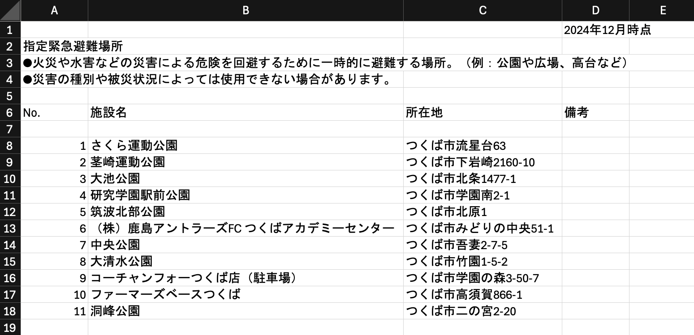

つくば市が公開している指定緊急避難場所のCSVは11件で、項目は「No / 施設名 / 所在地 / 備考」の4つです。デジタル庁の自治体標準オープンデータセットの39項目に変換し、住所から11件すべての緯度経度を補完して地図に表示できるようにしました。災害種別のうち「洪水」「地震」など5区分と想定収容人数は元のCSVに情報がないので、空欄のままです。

つくば市は[指定緊急避難場所のリストをオープンデータとして公開](https://www.city.tsukuba.lg.jp/soshikikarasagasu/shichokoshitsukikikanrika/gyomuannai/1/2/1000608.html)していますが、緯度経度などの位置情報や、災害種別ごとに使えるかどうかの情報は含まれていません。デジタル庁の[自治体標準オープンデータセット「指定緊急避難場所」](https://www.digital.go.jp/resources/open_data/municipal-standard-data-set-test)では、緯度・経度、災害種別8区分、想定収容人数など39項目が標準の形式として示されていて、同じ「指定緊急避難場所」でも、自治体によって公開している項目が違います。この記事では、つくば市のCSVを標準の形式に変換し、Queriaのデータカタログに登録した手順と、埋められなかった項目を説明します。対象は指定緊急避難場所だけで、一定期間滞在する指定避難所は含みません。

## 元のCSVは、列ヘッダが6行目にある

公式のCSVは、1行目に列ヘッダがある一般的な表の形式ではありません。1行目から5行目にはデータ名（指定緊急避難場所）、発行時点、災害種別に関する補足説明が入り、6行目に `No. / 施設名 / 所在地 / 備考` の列ヘッダがあります。7行目は空行で、レコードは8行目から始まります。



このまま `pandas.read_csv` や DuckDB の `read_csv` で読むと列ヘッダが自動で判別されないので、`skiprows` にあたる前処理が必要です。行番号を固定して読み飛ばすと、説明文の行数が変わったときに読み込めなくなるので、変換スクリプト [dataset-tsukuba/scripts/convert_shelter.py](https://github.com/queria-io/dataset-tsukuba/blob/main/scripts/convert_shelter.py) では、先頭のセルに `No.` を含む行を探してヘッダの位置を決めています。

## 11件すべてで緯度経度を補完できた

公式のCSVには11件の指定緊急避難場所が載っています。住所の文字列から緯度経度を補完できた件数は次のとおりです。

```sql
SELECT n AS "件数", geocoded AS "緯度経度を補完できた件数" FROM (SELECT COUNT(*) AS n, COUNT(latitude) AS geocoded FROM tsukuba.main.mart_tsukuba_emergency_shelter)
```

11件すべてで、住所の文字列から緯度経度を取得できました。

## 変換の手順

変換は次の3つの手順で行いました。

1. つくば市公式ページに掲載されているCSVを取得
2. [normalize-japanese-addresses](https://github.com/geolonia/normalize-japanese-addresses) で住所文字列を「都道府県 / 市区町村 / 町字 / 番地」の構成要素に分解し、緯度経度を取得
3. 自治体標準オープンデータセット「指定緊急避難場所」の39項目に再マッピングしてCSVとして書き出し

住所の正規化とジオコーディングには、Geolonia 社が公開している住所正規化ライブラリを使いました。全角と半角、丁目の有無、漢数字とアラビア数字の混在などの表記ゆれを正規化し、町字レベルの緯度経度を返します。座標は町字レベルなので、施設の建物の位置ではありません。

デジタル庁が整備している[アドレス・ベース・レジストリ](https://www.digital.go.jp/policies/base_registry_address)をデータソースとする [abr-geocoder-web](https://github.com/digital-go-jp/abr-geocoder-web) を使うほうが望ましいと考えています。住居表示・地番までを公的なデータセットで照合でき、ジオコーディング結果の出典も公的なものとして示せるためです。今回は形式の変換を優先して Geolonia のライブラリを使い、ABR への切り替えは今後の改善点として検討しています。

変換スクリプトは [dataset-tsukuba/scripts/convert_shelter.py](https://github.com/queria-io/dataset-tsukuba/blob/main/scripts/convert_shelter.py) にあります。

## 11件は市の中心部から茎崎地区まで市内に分散している

緯度経度を補完したので、11件の指定緊急避難場所を地図に表示できます。

```map
type: map
layers:
  - from: tsukuba_boundary
    geojson: geojson
  - from: shelters
    lng: longitude
    lat: latitude
    label: name
lng: 140.09
lat: 36.08
zoom: 10
```

市の中心部のほか、TX沿線地区、旧筑波町域、茎崎地区まで、市内の広い範囲に指定されています。

## 変換後のテーブルは、多くの項目が空欄

変換後のテーブルです。自治体標準オープンデータセットで定義されている項目をすべて列として持っていて、ここでは全列を横スクロールで表示しています。多くの項目が空欄の理由は、次の節で説明します。

```sql
SELECT
  ROW_NUMBER() OVER (ORDER BY shelter_id) AS "No",
  local_government_code AS "全国地方公共団体コード",
  name AS "名称",
  name_kana AS "名称（カナ）",
  name_en AS "名称（英字）",
  full_address AS "所在地",
  prefecture AS "都道府県",
  city AS "市区町村",
  town AS "町字",
  addr_detail AS "番地以下",
  building AS "建物名等（方書）",
  latitude AS "緯度",
  longitude AS "経度",
  elevation AS "標高",
  phone AS "電話番号",
  phone_ext AS "内線番号",
  email AS "連絡先メールアドレス",
  form_url AS "連絡先FormURL",
  contact_note AS "連絡先備考",
  postal_code AS "郵便番号",
  lg_name AS "地方公共団体名",
  flood AS "災害種別_洪水",
  landslide AS "災害種別_崖崩れ・土石流・地滑り",
  storm_surge AS "災害種別_高潮",
  earthquake AS "災害種別_地震",
  tsunami AS "災害種別_津波",
  large_fire AS "災害種別_大規模な火事",
  inland_flooding AS "災害種別_内水氾濫",
  volcanic AS "災害種別_火山現象",
  duplicated_with_shelter AS "指定避難所との重複",
  capacity AS "想定収容人数",
  target_areas AS "対象となる町会・自治会",
  url AS "URL",
  image_url AS "画像URL",
  image_license AS "画像ライセンス",
  note AS "備考"
FROM tsukuba.main.mart_tsukuba_emergency_shelter ORDER BY shelter_id
```

## 災害種別の5区分と想定収容人数は、元のCSVに情報がない

公式のCSVに含まれていない情報は、項目を埋められていません。

- 災害種別フラグ: 各避難場所がどの災害種別に対応するかの情報が、公式のCSVに含まれていません。「高潮」「津波」「火山現象」には "0" を設定していますが、これはつくば市が内陸にあるという地理的条件からの判断で、市が公表した値ではありません。「洪水」「崖崩れ・土石流・地滑り」「地震」「大規模な火事」「内水氾濫」の5区分は空欄です。判断できない区分を0にすると「その災害には使えない場所」という誤った意味になるためです。値を決めるには、データを発行している部署への確認か、同種のデータを公開しているほかの自治体のデータとの照合が必要です
- 想定収容人数: 公式のCSVに記載がなく、現時点では入っていません
- 標高、電話番号、対象町会・自治会などの付帯情報: 同様に公式のCSVに記載がなく、入っていません

そのため、このデータから、どの災害のときにどこへ避難できるかは判定できません。実際の避難先は、つくば市が公表する最新のハザードマップと避難情報で確認してください。

自治体標準オープンデータセットの項目に変換すると、公開されているデータに推奨項目のうちどれが足りないかを一覧で確認できます。

## まとめ

つくば市の指定緊急避難場所のCSVは4項目で、地図への表示やほかのデータとの結合には、緯度経度の補完などの追加の作業が必要でした。緯度経度のように住所から外部で補完できる項目もありますが、災害種別や想定収容人数は、元のデータを持っている自治体でなければ整備できません。ほかの自治体の同名のデータは項目の構成が違うので、そのまま並べて比較することはできません。

## データの出典

本記事は、つくば市が公開する[指定緊急避難場所](https://www.city.tsukuba.lg.jp/soshikikarasagasu/shichokoshitsukikikanrika/gyomuannai/1/2/1000608.html)のCSVを、デジタル庁の[自治体標準オープンデータセット](https://www.digital.go.jp/resources/open_data/municipal-standard-data-set-test)の項目に変換したものです。カタログのデータは2026年7月11日時点のものです。

Queriaは、つくば市の指定緊急避難場所を自治体標準オープンデータセットの項目に変換し、列名・単位・文字コードを統一して、緯度経度の補完の出典を列の説明に書いて公開しています。本記事で変換した[つくば市の指定緊急避難場所テーブル](/datasets/queria/tsukuba/main/mart_tsukuba_emergency_shelter)から、地図に表示したりほかのデータと結合したり、空欄の項目を確認したりできます。

```sql id=shelters
SELECT CAST(ROW_NUMBER() OVER (ORDER BY shelter_id) AS VARCHAR) AS no, name, full_address, latitude, longitude FROM tsukuba.main.mart_tsukuba_emergency_shelter ORDER BY shelter_id
```

```sql id=shelter_count
SELECT COUNT(*) AS n, COUNT(latitude) AS geocoded FROM tsukuba.main.mart_tsukuba_emergency_shelter
```

```sql id=tsukuba_boundary
SELECT ST_AsGeoJSON(m.geometry) AS geojson, 1 AS z_val FROM nlftp.boundary.municipality m, (VALUES (1), (2)) v(i) WHERE m.prefecture_code = '08' AND m.city_name = 'つくば市'
```
